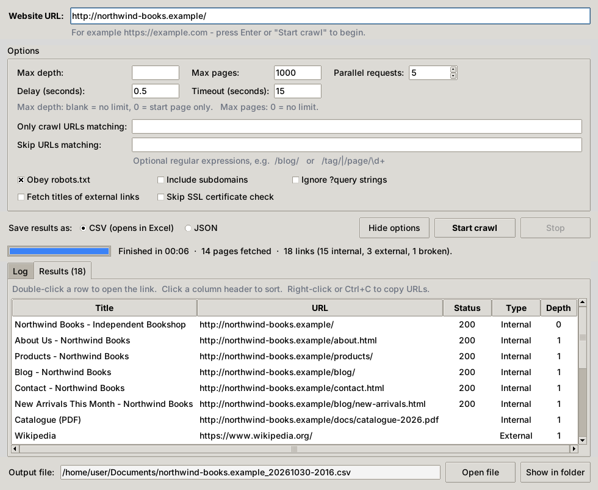

# Link Crawler

A fast, polite Python crawler that walks a website recursively and collects **every link it finds together with its title**. Use it as a **desktop app** (enter a URL, click *Start crawl*, choose where to save) or from the **command line**. Results are saved as **CSV** (opens straight in Excel) or **JSON**.



## Features

- **Desktop app** – type a URL, press *Start crawl*, pick the folder and file name. Live progress, a log, a sortable results table, and *Stop* at any time
- **Recursive crawl** of a whole site (breadth-first), with optional depth and page limits
- **Collects every link** – internal pages, external links and files (PDFs, images, documents …)
- **Titles for everything** – the real `<title>` of every crawled page; the link text for links that weren't fetched. Optionally fetch external pages too, to get their real titles
- **Fast but polite** – parallel workers plus a per-host delay between requests
- **Respects `robots.txt`** by default, including `Crawl-delay`
- **Robust** – retries with back-off on timeouts, 429 and 5xx; follows and records redirects; skips huge pages
- **Any language** – detects page encodings correctly; the CSV is written as UTF-8 with BOM so Excel shows Bengali, Arabic, Chinese … titles properly
- **Filters** – include/exclude URLs by regex, crawl subdomains, ignore query strings
- **Stops cleanly** (Stop button or Ctrl+C) and still saves everything collected so far
- Works as a **desktop app**, a **command-line tool** or an **importable Python module**

## Requirements

- Python **3.9 or newer**
- The packages in [`requirements.txt`](requirements.txt): `requests`, `beautifulsoup4`, `lxml` (optional)
- For the desktop app: **Tkinter**, which is part of Python, so pip doesn't install it:
  - **Windows / macOS** (installers from python.org): already included. On Windows, keep *"tcl/tk and IDLE"* ticked in the installer.
  - **Ubuntu / Debian**: `sudo apt install python3-tk`
  - **Fedora**: `sudo dnf install python3-tkinter`
  - **macOS with Homebrew Python**: `brew install python-tk`

## Installation

```bash
git clone https://github.com/<your-username>/<your-repo>.git
cd <your-repo>

python -m venv .venv
# Windows
.venv\Scripts\activate
# Linux / macOS
source .venv/bin/activate

pip install -r requirements.txt
```

## Desktop app

```bash
python gui.py
```

On Windows you can also double-click `gui.py`, or run `pythonw gui.py` so no console window appears. `python gui.py https://example.com` opens the app with the URL already filled in.

1. Enter the **website URL** (`example.com` works too – `https://` is added for you).
2. Optionally adjust the **options** (they are explained below). On small screens they start hidden – click **Show options**.
3. Choose **CSV** or **JSON** and click **Start crawl** (or press Enter).
4. A save dialog asks **where to save the results and the file name**. A name such as `example.com_20261030-2003.csv` is suggested.
5. Follow the progress in the **Log** tab. Click **Stop** to end early – everything collected so far is still saved.
6. When it's done, the **Results** tab lists every link. You can:
   - double-click a row to open the link in your browser
   - click a column header to sort (for example by *Status* to find broken links, which are shown in red)
   - right-click or press Ctrl+C to copy URLs
7. Click **Open file** or **Show in folder** to get to the saved file.

If the file you choose is open in Excel, the app tells you before crawling. If saving fails at the end, it offers to save somewhere else so the crawl isn't lost.

## Command line

```bash
# Crawl a whole site (up to 1000 pages) and save to crawl_results.json
python crawler.py https://example.com

# Only 2 clicks deep, save as CSV
python crawler.py https://example.com --max-depth 2 --output links.csv

# No page limit, more workers, shorter delay (only for sites that can take it)
python crawler.py https://example.com --max-pages 0 --workers 10 --delay 0.1

# Only crawl the /docs/ section, skip tag and pagination pages
python crawler.py https://example.com --include /docs/ --exclude /tag/ --exclude "page=\d+"

# Also visit every external link once to get its real title and HTTP status
python crawler.py https://example.com --external-titles -o all_links.csv

# Intranet site with a self-signed certificate
python crawler.py https://intranet.local --insecure
```

```text
$ python crawler.py https://example.com -o links.csv
10:15:02 INFO    Crawling https://example.com/  (max depth: unlimited, max pages: 1000, workers: 5)
10:15:03 INFO    [1/1000] depth 0  200  https://example.com/  | Home
10:15:03 INFO    [2/1000] depth 1  200  https://example.com/about  | About Us
10:15:04 INFO    [3/1000] depth 1  301  https://example.com/blog -> https://example.com/blog/  | Blog
...
10:15:41 INFO    Done in 38.6s: 74 pages fetched, 312 unique links (241 internal, 71 external, 2 broken).
```

## Options

The same settings are available in the desktop app (left) and on the command line (right).

| Desktop app | Command line | Default | Description |
|---|---|---|---|
| Website URL | `url` | – | Start URL |
| Save dialog | `-o`, `--output FILE` | `crawl_results.json` | Output file. Format is chosen by extension: `.csv` or `.json` |
| Max depth | `-d`, `--max-depth N` | no limit | Follow links at most N clicks from the start page (`0` = start page only) |
| Max pages | `-n`, `--max-pages N` | `1000` | Stop after fetching N pages (`0` = no limit) |
| Parallel requests | `-w`, `--workers N` | `5` | Number of requests made at the same time |
| Delay (seconds) | `--delay SECONDS` | `0.5` | Minimum pause between two requests to the same host |
| Timeout (seconds) | `--timeout SECONDS` | `15` | Timeout per request |
| – | `--retries N` | `2` | Retries for timeouts, 429 and 5xx responses |
| – | `--user-agent STRING` | `Mozilla/5.0 (compatible; LinkCrawler/1.1.0)` | User-Agent header |
| Include subdomains | `--include-subdomains` | off | Also crawl subdomains (e.g. `blog.example.com`) |
| Only crawl URLs matching | `--include REGEX` | – | Only crawl URLs matching this regex (repeatable on the command line) |
| Skip URLs matching | `--exclude REGEX` | – | Never crawl URLs matching this regex (repeatable on the command line) |
| Ignore ?query strings | `--ignore-query` | off | Drop `?query` strings – stops endless calendar/filter/sort pages |
| Obey robots.txt (untick) | `--ignore-robots` | obeyed | Don't obey `robots.txt` – only for sites you own or may crawl |
| Fetch titles of external links | `--external-titles` | off | Request each external link once to get its real title and status |
| Skip SSL certificate check | `--insecure` | off | Skip TLS certificate verification |
| – | `-v`, `--verbose` / `-q`, `--quiet` | – | More / less console output |

Notes:

- `www.example.com` and `example.com` are treated as the same site.
- *Include* / *exclude* decide which pages are **crawled**. Every link is still **recorded** in the results.
- Links deeper than the depth limit are recorded (with their link text as title) but not fetched.
- In the desktop app, one regular expression per field; use `|` for several, e.g. `/tag/|/page/\d+`.
- Command-line exit codes: `0` success, `1` the start page couldn't be crawled, `2` invalid arguments, `130` stopped with Ctrl+C (results are still saved).

## Output

Each unique URL appears once, in the order it was discovered.

| Column | Meaning |
|---|---|
| `url` | The link (normalised: no `#fragment`, lower-case host, no default port) |
| `title` | Page `<title>` if the page was fetched, otherwise the link text |
| `title_source` | `page`, `anchor` (link text) or empty |
| `status` | HTTP status code; for redirects, the redirect code (301, 302 …) |
| `internal` | `True` if the link is on the crawled site |
| `fetched` | `True` if the crawler requested this URL |
| `depth` | Clicks away from the start page |
| `found_on` | First page that linked to this URL |
| `redirected_to` | Where the URL redirected to, if it did |
| `content_type` | e.g. `text/html`, `application/pdf` |
| `error` | Network error, `blocked by robots.txt`, … |

JSON output adds a summary at the top:

```json
{
  "start_url": "https://example.com/",
  "started_at": "2026-10-30T14:15:02+00:00",
  "finished_at": "2026-10-30T14:15:41+00:00",
  "pages_fetched": 74,
  "total_links": 312,
  "internal_links": 241,
  "external_links": 71,
  "broken_links": 2,
  "interrupted": false,
  "crawler_version": "1.1.0",
  "elapsed_seconds": 38.6,
  "links": [
    {
      "url": "https://example.com/about",
      "title": "About Us",
      "title_source": "page",
      "status": 200,
      "internal": true,
      "fetched": true,
      "depth": 1,
      "found_on": "https://example.com/",
      "redirected_to": "",
      "content_type": "text/html",
      "error": ""
    }
  ]
}
```

## Use it from Python

```python
from crawler import Crawler, save_results

crawler = Crawler("https://example.com", max_depth=2, max_pages=200, workers=4)
records = crawler.run()          # call crawler.stop() from another thread to end early

for link in records:
    if link.internal and link.status == 200:
        print(link.url, "-", link.title)

broken = [link.url for link in records if link.broken]
save_results("links.csv", records, crawler.summary())
```

## Build a standalone app (optional)

To share the desktop app with someone who doesn't have Python, build a single executable with [PyInstaller](https://pyinstaller.org/):

```bash
pip install pyinstaller
pyinstaller --onefile --windowed --name LinkCrawler gui.py
```

The program is created in the `dist/` folder (`dist\LinkCrawler.exe` on Windows). Build on the operating system you want to run it on: a Windows `.exe` must be built on Windows. `build/`, `dist/` and `*.spec` are ignored by git.

## How it works

1. Starts at the given URL and fetches pages **breadth-first** (nearest pages first), using a thread pool.
2. For each HTML page it reads the title (`<title>` → `og:title` → first `<h1>`) and every `<a href>` / `<area href>`.
3. Links are made absolute (respecting `<base href>`), normalised and de-duplicated.
4. Links on the same site are queued for crawling; external links and file links are recorded only.
5. Redirects, broken links and errors are recorded instead of stopping the crawl.

The desktop app runs the same crawler in a background thread, so the window stays responsive.

## Troubleshooting

| Problem | Fix |
|---|---|
| `No module named 'tkinter'` / `_tkinter` | Install Tkinter – see [Requirements](#requirements) |
| `No module named 'requests'` (or `bs4`) | Run `pip install -r requirements.txt` in the same Python / virtual environment you start the app with |
| *SSL error* on an intranet site | Tick *Skip SSL certificate check* (`--insecure`) |
| *blocked by robots.txt* | The site asks crawlers to stay away from that page. Untick *Obey robots.txt* (`--ignore-robots`) only if you own the site or have permission |
| Few or no links on a modern web app | See [Limitations](#limitations) – the page builds its links with JavaScript |
| *Can't save … Permission denied* | The file is open in another program (often Excel). Close it, or choose another name |

## Crawl responsibly

- Only crawl sites you are allowed to crawl, and check their terms of service.
- Keep `robots.txt` enabled and the delay reasonable – a crawler that hammers a server can get your IP blocked.
- Use the page and depth limits to keep crawls small while testing.

## Limitations

- Pages that build their links with JavaScript (many React/Vue/Angular single-page apps) show few or no links, because the crawler reads the HTML the server sends and doesn't run JavaScript. A headless browser (e.g. Playwright) is needed for those.
- Pages behind a login are not crawled.
- Only the first 5 MB of a page is parsed.

## Project structure

```text
.
├── gui.py            # desktop app (Tkinter)
├── crawler.py        # the crawler (command line + importable module)
├── requirements.txt  # Python dependencies
├── docs/
│   └── screenshot.png
├── README.md
└── .gitignore
```
